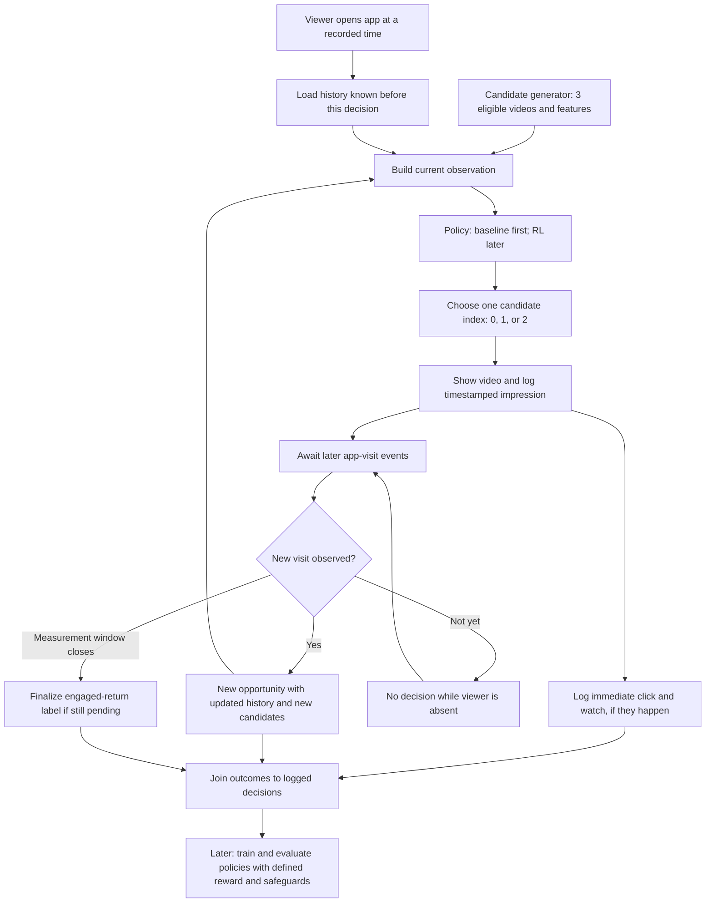

# Video recommender RL — proposed system design

**Status:** design with a candidate-generator prototype, random, profile-based, and recorded-watch-history recommendation baselines, a one-video synthetic reaction sampler, independent visit-gap sampler, generated one- and two-visit log examples, a small *separate* video-dependent return illustration, and a descriptive seven-day label calculator; no trained model or validated return simulator. This learning project will use timestamped **synthetic** events to practice an end-to-end recommendation workflow. It is not a reproduction of YouTube or a deployed client system. Decisions and remaining questions are recorded in [DISCUSSION_NOTES.md](DISCUSSION_NOTES.md).

## Step 1 — Define the problem

**Decision:** At a recommendation opportunity during a viewer's visit, choose **one** of three eligible candidate videos. The three-video shortlist is an educational simplification, not an RL requirement. The candidate generator supplies the options; the policy chooses one. Cosine similarity could help retrieve candidates, but is **not** the RL model.

**Candidate-generation prototype:** [candidate_generator.py](candidate_generator.py) filters a tiny synthetic catalog for eligibility and duration of at least 30 seconds, then uses seeded random selection to supply three **distinct** videos from different topics when possible (e.g., cooking, sports, music). With fewer than three topics, remaining slots come from different videos with possibly repeated topics (e.g., cooking A, cooking B, sports C). The fixed seed reproduces a run's sequence, not necessarily the same shortlist each visit. The eventual model cannot request a cooking video absent from the shortlist. If fewer than three videos are eligible, the prototype raises `ValueError`; production behavior for this case is not yet specified. The generator supplies only options: it does not choose which video is recommended or simulate visits.

**Measurement goal (agreed):** For an earlier recommendation, did the viewer **return to the same app within seven days and watch any video**? The later video can be from a different channel; it does not have to be the one recommended earlier. **Log every app visit**, including visits without a watch, but a visit without a qualifying watch is **not** an *engaged return*. Such a visit does not turn an earlier pending label into **yes** or **no**; it stays pending until a qualifying engaged return occurs or its seven-day window closes. Record immediate response to the chosen video separately from engaged return.

**Agreed watch rule:** At least **30 seconds of playback** counts as a watch; a click with less playback remains a click but not a watch. The threshold is a synthetic-project choice, not a research or product standard. Candidate videos must be long enough for it to be achievable. **Agreed window boundary:** Measure **7 × 24 hours after the recommendation's impression timestamp**. The viewer must start a new visit after that impression and complete the qualifying 30 seconds of playback by the deadline (inclusive). A later watch still belongs in the logs but does not count *within seven days* for this decision; a new recommendation would start its own window. **Agreed descriptive labeling:** A later engaged visit can mark every earlier recommendation for that viewer **yes** if the visit began after its impression and the qualifying watch completed within its own seven-day window. Count that visit **once** in viewer-level totals, not once per recommendation. A video first shown during that visit stays **pending** until a later visit. These labels describe timing, **not which video caused the return or which action should receive RL credit**. **Not yet agreed:** Training-reward and causal-credit rules. Do not treat the measurement definition as an already specified RL reward. Business impact is also not yet measured: a synthetic engaged return does not prove real retention or revenue.

## End-to-end flow



**Important:** The policy sees only *past and current* information. A later visit might happen days later; it is not an input to the earlier decision. “No visit tomorrow” does **not** automatically end an episode. The simulator's private state can generate viewer behavior, but the policy must not see that hidden state or future events. The diagram is a design, not an implemented pipeline.

## Step 2 — Data and observation

**Visit and watch counting (agreed):** Log playback duration even when it is less than 30 seconds: for example, a 5-second `video_playback` row is historical feedback available to later decisions, but is **not** a qualifying watch. A later model may learn from patterns of short playback; one short play alone does not reveal a viewer's private preference. One app visit may contain several video impressions and watches. Each video reaching 30 seconds is a qualifying watch, but the visit counts as **one engaged visit** for viewer-level return metrics, not one per watched video. A viewer can also make multiple visits on the same calendar day; count distinct visits rather than assuming one visit per day. **First working version:** the app asks the **same model once per visit** for one recommendation. The viewer may still watch several videos, including ones found through search or their own choice—log those watches, but **do not attribute their selection to the policy**. **Later extension:** the app may ask the same model to recommend again within a visit; that would be a second decision, not a second model or a return visit. Within a later qualifying visit, apply the previously agreed descriptive yes/pending labels to earlier recommendations based on their individual windows, without counting the underlying visit multiple times.

For each recommendation opportunity, the policy's **one current observation** can contain many values:

| Part | Example available *before* the action | What it does not contain |
| --- | --- | --- |
| Viewer history | Prior recorded watches by topic, recent skips, last known click/watch | Viewer preference known only to the simulator; future events |
| Timing/context | Current visit timestamp, visit number, time since last observed visit | A future return timestamp |
| Three candidate-video features | Topic, other content features, optionally an estimated immediate-click score or embedding per candidate | Whether each candidate will be clicked today |

The policy's **action** selects candidate `0`, `1`, or `2` from the *current* shortlist. A new visit receives a **new** observation. We can start with understandable named fields, then define the exact numerical encoding when implementing the environment; there is no requirement that every feature or embedding lie between −1 and 1.

**Example of the simulator/policy boundary:** To generate synthetic activity, the simulator might privately assign viewer U1 an interest in cooking. At decision D1 the policy cannot read that interest; it chooses cooking video A from the available candidates using only its current observation. If U1 watches A after D1, that watch is logged as D1 feedback. At a later visit, decision D2 may use the **recorded watch of A** as past behavior when choosing among D2's candidates—for example, a different cooking video. D1 could not use its own later feedback, and D2 cannot see the simulator's private preference or its own future outcome. Private interest is an illustrative generation mechanism, **not** a finalized simulator rule or a field in the current hand-written event log.

A conceptual log may have a decision ID, viewer ID (synthetic), visit and impression timestamps, current candidate set, chosen action, policy version, immediate click/watch events, and subsequent visit/watch events. Actual record fields, privacy rules, and event linking will be specified before coding. For reliable off-policy evaluation on *real* logs, we would additionally need chosen-action probabilities and sufficient coverage of candidate actions. Synthetic replay is not evidence of how real unshown videos would have performed.

## One timeline: day 4 to day 8

```text
Day 4: viewer visits; policy sees only history through day 4 + today's candidates.
       It chooses video A; the system logs the impression and an immediate click.
       engaged_return_within_7_days = pending.
Day 5–7: viewer absent; no policy call, no shown video, no skipped-video label.
Day 8: viewer visits again and watches video B in the app.
       day-4 engaged_return_within_7_days = yes.
       If there is a day-8 recommendation, it is a separate decision.
Day 11: day-4 measurement window closes; if no qualifying engaged return
        occurred, its label would become no. An earlier yes remains yes.
```

The day-8 video can come from the **same or a different channel**. An app open without watching is not an engaged return. If the data end before a window closes, the outcome is unresolved (**pending**, not automatically **no**). The 30-second rule defines a qualifying watch; overlapping decision-level labels may both become **yes**, but the actual engaged visit is still one viewer event and training credit remains undecided. Observing day-8 activity after video A does **not** prove video A caused it.

The [SlateQ paper](https://ar5iv.labs.arxiv.org/html/1905.12767) discusses consecutive observed visits spaced apart in time and uses elapsed time between visits in its long-term evaluation. It does **not** disclose our proposed fields, fixed history window, or seven-day return label.

## Step 3 — Policy, simulator, and reward

The first implemented **non-RL baseline** in [random_baseline.py](random_baseline.py) chooses one index uniformly from the current shortlist without looking at viewer history or candidate topic; run it to see both the shortlist and selected video. [profile_baseline.py](profile_baseline.py) is another hand-written **non-RL baseline**: it favors candidates whose topic matches a *recorded* user interest, breaking ties with seeded randomness. If no candidate matches or no interest is recorded, it chooses randomly from the shortlist. The profile demo uses an illustrative recorded preference and shortlist; the one- and two-visit log exercises use the random baseline, so their logged D2 does not personalize or learn from feedback. Separately, [history_baseline.py](history_baseline.py) demonstrates a hand-written non-RL choice for D2 using E4's earlier 40-second playback of video A: it looks up A's cooking topic in the catalog, then chooses cooking candidate B from D2's shortlist. This *reconsiders* D2 without altering the original random log or sampling a new response. A prior 5-second playback is logged but does not count as a qualifying watch for this simple rule; absent a qualifying watch or a matching candidate, selection falls back to random. A later **non-RL baseline** could use an estimated immediate-click score. A future RL policy can observe the **same** current viewer and candidate features and choose a video while trying to improve a precisely specified long-term objective. If the choice does not affect later state and opportunities, a supervised ranker or contextual bandit might be sufficient instead of sequential RL.

**First response sampler:** [viewer_reaction.py](viewer_reaction.py) uses the simulator's private topic interest and the shown video's topic to sample one immediate outcome: ignore, click/play 5 seconds, or click/play 40 seconds. The respective probabilities are invented teaching values: 20%/20%/60% for a matching topic and 50%/30%/20% otherwise. No result is guaranteed. A seeded random generator makes examples repeatable; no visit schedule, timestamped output log, or return label is generated yet. A later decision may eventually use *recorded playback*, not the simulator's private interest.

**First generated event-log example:** [one_visit_log.py](one_visit_log.py) uses the random baseline and reaction sampler to create one U1 visit and writes `generated_one_visit.csv` without overwriting existing data. The rows contain a visit start, impression, and an optional click and playback duration; `source=random_baseline` on decision-related rows distinguishes this policy from a trained model. The illustrative timestamp gaps within this one visit are fixed, not sampled visit intervals. Candidate shortlists and the simulator's private interest are **not logged as policy inputs** in this exercise. There is no second visit, seven-day label, or reward yet.

**Second visit logging exercise:** [two_visit_log.py](two_visit_log.py) uses that independent gap sampler to record a later V2, D2, and its possible immediate response in `generated_two_visits.csv`. The output shows that D1's events are available before D2, but D2 is selected by a random baseline that **does not use that history**. D2's own response is not available before D2. A separate calculator now derives descriptive seven-day labels from the log; causal return credit is still not computed. A randomly scheduled return cannot establish that D1's selected video caused it.

**Visit-gap exercise:** [visit_timing.py](visit_timing.py) independently samples 1-, 2-, 4-, or 8-day gaps with equal chance and a fixed seed. It prints irregular visit timestamps, not interaction-event records. These invented gaps are unaffected by the recommended video or playback and therefore cannot train a policy to improve return behavior. This exercise remains unchanged. Separately, [video_dependent_return.py](video_dependent_return.py) and [compare_return_journeys.py](compare_return_journeys.py) illustrate a *hypothetical* D2→V3 mechanism: 0/5/40-second D2 playback gives invented 10%/30%/70% chances of a V3 app open; if V3 occurs, D3's separately sampled response can provide the qualifying 30-second watch needed for D2's descriptive engaged-return label. One fixed draw makes a V3 occur after history-based B but not after random C; no old event CSV is changed. This is an assumption-driven example, **not** a validated simulator, causal or business lift, or a training reward.

**Descriptive return label:** [engaged_return.py](engaged_return.py) reads event rows for a decision and returns `pending`, `yes`, or `no` as of a specified time. It requires a *later* visit by the same viewer and 30 seconds of playback of any video completed within that impression's seven-day window. `no` is returned only when the full window is observed without a qualifying watch; pass `observed_through` when data collection ended early. For `generated_two_visits.csv`, D1 is pending on Oct 8 (V2 has no playback), then no after Oct 11 10:01 with complete observation. For a runnable counterexample, [yes_return_example.py](yes_return_example.py) adds a *search-sourced* 40-second video C playback to V2 **in memory**. D1 then becomes `yes`, while D2 stays `pending`: the watch occurred in D2's own visit, not in a subsequent visit. No existing event CSV is modified. This is **not a causal reward**, and the added watch is illustrative rather than sampled.

**Training reward is open.** Earlier drafts contained an illustrative `click + 2 × return` rule, but the `2` was arbitrary and **is not agreed**. We also discussed a click-only reward that lets later visits create more opportunities for future clicks; that likewise does **not** automatically optimize “engaged return within seven days.” Before simulator code, we must set the reward, when delayed feedback is available, how a later visit is credited when many recommendations preceded it, and what the episode/window boundary means. Keep click, watch, engaged-return, and user-quality metrics visible separately even if reward combines them.

## Step 4 — Train and evaluate, later

1. Validate event timestamps, the observation/action contract, deterministic synthetic seeds, delayed-label resolution, no future leakage, and inactivity gaps.
2. Produce synthetic logs from a baseline; inspect at least one viewer journey and report click/watch/engaged-return metrics separately.
3. Implement and train an RL policy **only after** simulator rules and baseline evaluation are clear. A saved policy's evaluation should not retrain it.
4. Compare policies under a shared, reproducible synthetic setup and separate evaluation seeds. Because actions alter future state, matching initial seeds does not force the same later trajectories.
5. Report uncertainty, inspect failure cases, and do not infer client business lift from a simulator.

There are no trained models or measured results to report yet.

## Step 5 — Deployment and monitoring boundaries

The learning project may eventually load a saved policy and run it against the synthetic environment; it will **not** serve real users. A *possible* real client architecture would include eligible-candidate retrieval, a low-latency policy service, hard content/user restrictions, versioned decision logging, timestamped outcome joins, offline checks, and a limited randomized online comparison with rollback. Monitor latency, missing logs, freshness, skipped or complained-about content, engaged returns, and the client's actual business metric. This is a proposed adaptation, not a claim about any company's private stack.

## Step 6 — Trade-offs and next checkpoint

**Why pursue long-term feedback?** Maximizing only immediate clicks may favor short-lived attention, while a later engaged visit could signal more durable usefulness. But “more visits” is not necessarily better if people are unhappy, and proving causation or revenue impact requires client-specific measurement. A synthetic pipeline is for **learning implementation and evaluation**, not forecasting a client's ROI.

**Next checkpoint:** define event schemas and the exact seven-day measurement boundaries with one worked viewer journey, then separately settle the training reward and attribution rule. Proceed **one learning stage at a time**; do not scaffold or train everything in one step.

## References

- [SlateQ: Reinforcement Learning for Slate-based Recommender Systems](https://ar5iv.labs.arxiv.org/html/1905.12767) — published research on long-term recommendation and visits separated in time, **not** this toy system's schema or business results.
- [Gymnasium: Create a Custom Environment](https://gymnasium.farama.org/introduction/create_custom_env/) — future `reset`/`step` interface.
- [Stable-Baselines3: Custom Environments](https://stable-baselines3.readthedocs.io/en/master/guide/custom_env.html) — compatibility guidance for a later learning stage.
