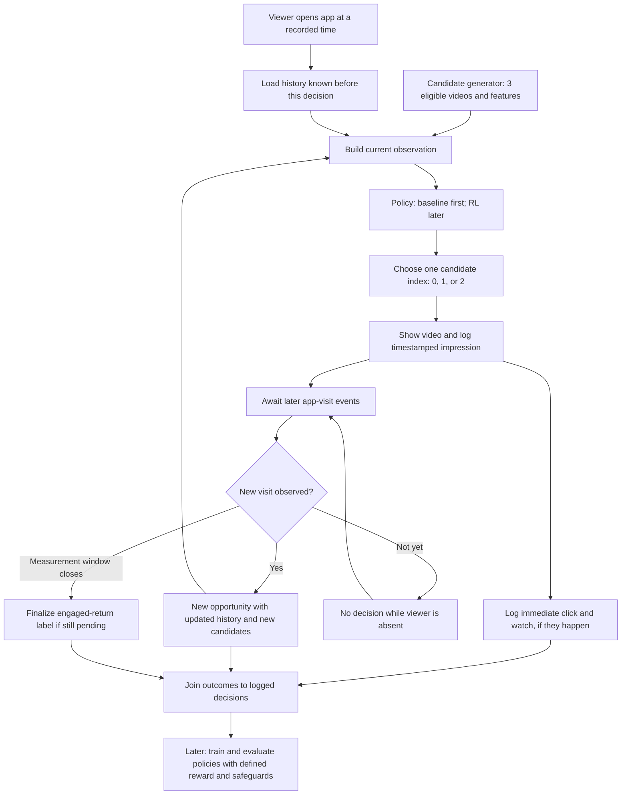

# Video recommender RL — proposed system design

**Status:** design only; not implemented. This learning project will use timestamped **synthetic** events to practice an end-to-end recommendation workflow. It is not a reproduction of YouTube or a deployed client system. Decisions and remaining questions are recorded in [DISCUSSION_NOTES.md](DISCUSSION_NOTES.md).

## Step 1 — Define the problem

**Decision:** At a recommendation opportunity during a viewer's visit, choose **one** of three eligible candidate videos. The three-video shortlist is an educational simplification, not an RL requirement. The candidate generator supplies the options; the policy chooses one. Cosine similarity could help retrieve candidates, but is **not** the RL model.

**Measurement goal (agreed):** For an earlier recommendation, did the viewer **return to the same app within seven days and watch any video**? The later video can be from a different channel; it does not have to be the one recommended earlier. A visit without a watch is a *visit*, not an *engaged return*. Record immediate response to the chosen video separately from engaged return.

**Agreed watch rule:** At least **30 seconds of playback** counts as a watch; a click with less playback remains a click but not a watch. The threshold is a synthetic-project choice, not a research or product standard. Candidate videos must be long enough for it to be achievable. **Not yet agreed:** The seven-day boundary, assignment of later outcomes when several recommendations occur, and **training reward**. Do not treat the measurement definition as an already specified RL reward. Business impact is also not yet measured: a synthetic engaged return does not prove real retention or revenue.

## End-to-end flow



**Important:** The policy sees only *past and current* information. A later visit might happen days later; it is not an input to the earlier decision. “No visit tomorrow” does **not** automatically end an episode. The simulator's private state can generate viewer behavior, but the policy must not see that hidden state or future events. The diagram is a design, not an implemented pipeline.

## Step 2 — Data and observation

For each recommendation opportunity, the policy's **one current observation** can contain many values:

| Part | Example available *before* the action | What it does not contain |
| --- | --- | --- |
| Viewer history | Prior recorded watches by topic, recent skips, last known click/watch | Viewer preference known only to the simulator; future events |
| Timing/context | Current visit timestamp, visit number, time since last observed visit | A future return timestamp |
| Three candidate-video features | Topic, other content features, optionally an estimated immediate-click score or embedding per candidate | Whether each candidate will be clicked today |

The policy's **action** selects candidate `0`, `1`, or `2` from the *current* shortlist. A new visit receives a **new** observation. We can start with understandable named fields, then define the exact numerical encoding when implementing the environment; there is no requirement that every feature or embedding lie between −1 and 1.

A conceptual log may have a decision ID, viewer ID (synthetic), visit and impression timestamps, current candidate set, chosen action, policy version, immediate click/watch events, and subsequent visit/watch events. Actual record fields, privacy rules, and event linking will be specified before coding. For reliable off-policy evaluation on *real* logs, we would additionally need chosen-action probabilities and sufficient coverage of candidate actions. Synthetic replay is not evidence of how real unshown videos would have performed.

## One timeline: day 4 to day 8

```text
Day 4: viewer visits; policy sees only history through day 4 + today's candidates.
       It chooses video A; the system logs the impression and an immediate click.
       engaged_return_within_7_days = pending.
Day 5–7: viewer absent; no policy call, no shown video, no skipped-video label.
Day 8: viewer visits again and watches video B in the app.
       day-4 engaged_return_within_7_days = yes.
       If there is a day-8 recommendation, it is a separate decision.
Day 11: day-4 measurement window closes; if no qualifying engaged return
        occurred, its label would become no. An earlier yes remains yes.
```

The day-8 video can come from the **same or a different channel**. An app open without watching is not an engaged return. If the data end before a window closes, the outcome is unresolved (**pending**, not automatically **no**). Exactly when a watch qualifies and how multiple decisions share later outcomes still require design. Observing day-8 activity after video A does **not** prove video A caused it.

The [SlateQ paper](https://ar5iv.labs.arxiv.org/html/1905.12767) discusses consecutive observed visits spaced apart in time and uses elapsed time between visits in its long-term evaluation. It does **not** disclose our proposed fields, fixed history window, or seven-day return label.

## Step 3 — Policy, simulator, and reward

A simple **non-RL baseline** can choose the candidate with the highest estimated immediate-click score. A future RL policy can observe the **same** current viewer and candidate features and choose a video while trying to improve a precisely specified long-term objective. If the choice does not affect later state and opportunities, a supervised ranker or contextual bandit might be sufficient instead of sequential RL.

**Training reward is open.** Earlier drafts contained an illustrative `click + 2 × return` rule, but the `2` was arbitrary and **is not agreed**. We also discussed a click-only reward that lets later visits create more opportunities for future clicks; that likewise does **not** automatically optimize “engaged return within seven days.” Before simulator code, we must set the reward, when delayed feedback is available, how a later visit is credited when many recommendations preceded it, and what the episode/window boundary means. Keep click, watch, engaged-return, and user-quality metrics visible separately even if reward combines them.

## Step 4 — Train and evaluate, later

1. Validate event timestamps, the observation/action contract, deterministic synthetic seeds, delayed-label resolution, no future leakage, and inactivity gaps.
2. Produce synthetic logs from a baseline; inspect at least one viewer journey and report click/watch/engaged-return metrics separately.
3. Implement and train an RL policy **only after** simulator rules and baseline evaluation are clear. A saved policy's evaluation should not retrain it.
4. Compare policies under a shared, reproducible synthetic setup and separate evaluation seeds. Because actions alter future state, matching initial seeds does not force the same later trajectories.
5. Report uncertainty, inspect failure cases, and do not infer client business lift from a simulator.

There are no trained models or measured results to report yet.

## Step 5 — Deployment and monitoring boundaries

The learning project may eventually load a saved policy and run it against the synthetic environment; it will **not** serve real users. A *possible* real client architecture would include eligible-candidate retrieval, a low-latency policy service, hard content/user restrictions, versioned decision logging, timestamped outcome joins, offline checks, and a limited randomized online comparison with rollback. Monitor latency, missing logs, freshness, skipped or complained-about content, engaged returns, and the client's actual business metric. This is a proposed adaptation, not a claim about any company's private stack.

## Step 6 — Trade-offs and next checkpoint

**Why pursue long-term feedback?** Maximizing only immediate clicks may favor short-lived attention, while a later engaged visit could signal more durable usefulness. But “more visits” is not necessarily better if people are unhappy, and proving causation or revenue impact requires client-specific measurement. A synthetic pipeline is for **learning implementation and evaluation**, not forecasting a client's ROI.

**Next checkpoint:** define event schemas and the exact seven-day measurement boundaries with one worked viewer journey, then separately settle the training reward and attribution rule. Proceed **one learning stage at a time**; do not scaffold or train everything in one step.

## References

- [SlateQ: Reinforcement Learning for Slate-based Recommender Systems](https://ar5iv.labs.arxiv.org/html/1905.12767) — published research on long-term recommendation and visits separated in time, **not** this toy system's schema or business results.
- [Gymnasium: Create a Custom Environment](https://gymnasium.farama.org/introduction/create_custom_env/) — future `reset`/`step` interface.
- [Stable-Baselines3: Custom Environments](https://stable-baselines3.readthedocs.io/en/master/guide/custom_env.html) — compatibility guidance for a later learning stage.
