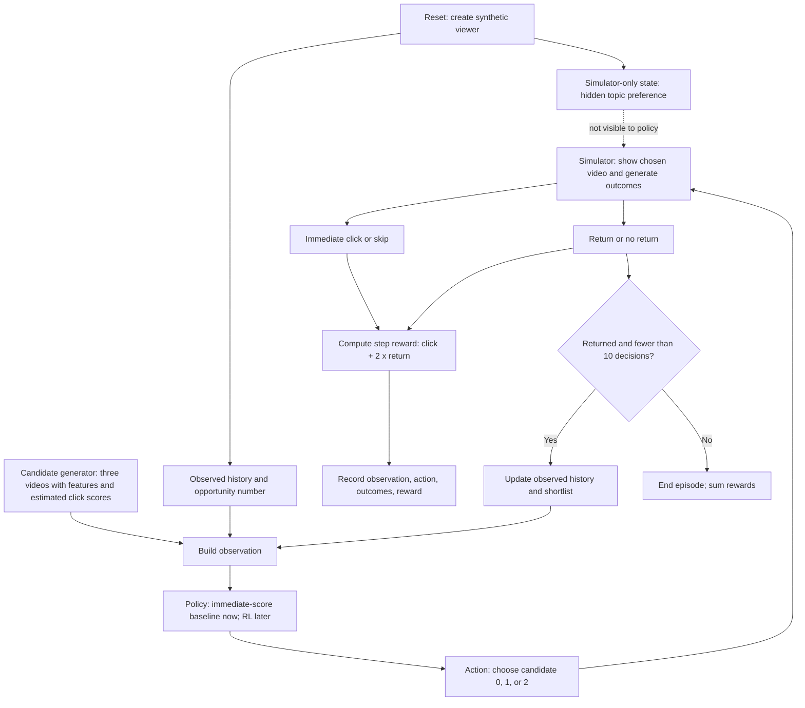

# Video recommender RL — system design before implementation

**Status:** proposed learning design, not implemented. This is a small synthetic system, not YouTube's architecture or a production recommendation service.

## 0. One-sentence problem statement

At each opportunity, choose **one of three shortlisted videos** for a synthetic viewer to improve their **cumulative engagement across opportunities**, without confusing an immediate click with a later return.



**Read the arrows as one decision loop:** current history and three candidate features form an observation; the policy selects a candidate; only then does the simulator reveal click and return outcomes. The hidden preference influences simulated outcomes but **never enters the policy observation directly**. The reward and next observation are available after the action, not before it. This diagram shows a **proposed** environment; its outcome rules and final-step return handling still need to be finalized before coding.

The candidate generator provides options; the **policy** chooses among them. Cosine similarity could be one way of generating candidates or scores, but **cosine similarity is not the RL policy**. For this first version we can supply three candidate features directly, without building a retrieval service.

### Why three videos?

**Three is a teaching choice, not an RL requirement or a rule taken from YouTube.** A shortlist of three lets us inspect every candidate and every possible action: Gymnasium's `Discrete(3)` represents the action indices `0`, `1`, and `2`. Here our policy chooses **one** of those three videos. [Gymnasium Discrete space](https://gymnasium.farama.org/api/spaces/fundamental/)

The [SlateQ paper](https://ar5iv.labs.arxiv.org/html/1905.12767) distinguishes the **candidate set** from the **slate shown to a viewer**. In one *simulation* experiment (§6.5), it selects a slate of **three** from **ten** candidates. Its YouTube application (§9) describes retrieving **hundreds** of candidates, with varying slate sizes. Our setup—**three candidates → one chosen video**—is deliberately smaller and is **not** a reproduction of either SlateQ experiment. Once the decision loop is clear, the number of candidates can change; that would also change the action space and observation format.

## Step 1 — Define the problem

| Question | Design for this learning project |
| --- | --- |
| Who is the user? | One synthetic viewer per episode. Their underlying topic preference is internal simulator state and is **not shown directly** to the agent. |
| What decision is made? | At each opportunity, pick exactly one of three candidate videos. Action `0`, `1`, or `2` is the candidate's position **in this opportunity's shortlist**, not its permanent ID. |
| Why use RL? | A choice can change the viewer's later history and chance of returning, affecting whether there are future opportunities. If later effects do not matter, a simpler ranking rule or contextual bandit could suffice. |
| What is the objective? | Maximize total reward across up to 10 decisions; report immediate clicks and returns **separately** so we can see any trade-off. |
| What is a baseline? | Choose the highest estimated immediate-click score; compare a random policy as a sanity check. Neither baseline learns from rewards. |
| What is in scope? | A seeded simulator, step-by-step examples, baseline comparison, an RL training experiment, and held-out evaluation—**in later stages**, not yet. |
| What is out of scope? | Real people, real videos, online serving, actual retention measurement, privacy-sensitive user logs, and proven business impact. |

**Critical uncertainty:** A generated return outcome is not evidence that a real person would return. We will state the simulator's assumptions explicitly and evaluate whether a policy exploits them.

## Step 2 — Data and observations

**Before the decision**, the observation builder can expose:

- **Viewer history:** recent watch-by-topic counts, recent skips, and the last selected video's outcome, as available at that time. These are clues, not the simulator's hidden true preference.
- **Context:** current opportunity number (a toy stand-in for time). A real system could consider time of day, but this simulator need not invent a clock.
- **Candidate features, repeated for each of the three videos:** topic, a clickbait/intensity indicator, and an estimated immediate-click score from a separate simple scoring rule.

For example, a conceptual observation might be:

```text
viewer_history = {cooking_watches: 2, sports_watches: 0, recent_skips: 1}
context        = {opportunity: 1 of 10}
candidates     = [
  {topic: sports,  clickbait: 1, immediate_score: 0.9},
  {topic: cooking, clickbait: 0, immediate_score: 0.6},
  {topic: travel,  clickbait: 0, immediate_score: 0.4},
]
hidden_preference = NOT INCLUDED IN THE OBSERVATION
future_click     = NOT INCLUDED IN THE OBSERVATION
future_return    = NOT INCLUDED IN THE OBSERVATION
```

This is a **human-readable sketch**, not a finalized numerical vector. The same observation can later be encoded as numbers for a Gymnasium/SB3 model. The policy must see the **features of all three candidates** to compare them; seeing a candidate's features is not the same as seeing what outcome that candidate would cause. Any click-score feature must be computed from information available before the decision—never from a future click.

**After the decision**, a trace record will contain the observation, action, clicked/skipped outcome, whether the synthetic viewer returned, reward components, and next observation (if one exists). When we implement training and evaluation, we will separate training seeds from evaluation seeds. For real logged-policy evaluation, we would also need to record the *probability assigned to the chosen action* and ensure candidate policies have adequate coverage in those logs; a historical log alone cannot tell us every unchosen video's outcome.

## Step 3 — Policy, environment, and reward

```text
Policy (baseline now; PPO later)
    input:  observed viewer history + current candidate features
    output: one candidate index (0, 1, or 2)

Environment (synthetic simulator, to build later)
    private state: hidden viewer preference and other simulation variables
    input:  selected candidate index
    output: click, return/no return, reward, next observation, episode status
```

We will initially use a deliberately simple reward proposal:

```text
step_reward = click_reward + 2 × return_reward
click_reward  = 1 if clicked, else 0
return_reward = 1 if the viewer returns for another opportunity, else 0
```

A click and a return are **different simulated events**: neither implies the other. The coefficient `2` is a learning-device choice, not an optimized product objective. This reward gives credit for a return immediately when the simulator resolves that outcome after the action; if we later decide to model a truly delayed return signal, we must specify exactly when it is revealed and how the last action receives credit. **Do not decide reward timing implicitly in code.**

**Episode:** reset with a new seeded viewer and starting history; at most 10 decisions. Stop earlier if the synthetic viewer does not return. The final decision cannot earn a “returns for another opportunity” reward unless the simulator explicitly models that return beyond the 10-decision boundary. Decide and document this boundary rule before writing the environment; otherwise last-step rewards will be inconsistent. The agent cannot choose whether the viewer returns; it only chooses the video and observes the consequence.

**Baseline versus RL:** The baseline picks the highest immediate-score candidate each time. A future RL policy receives the **same observable features and same action choices** but updates its decision rule during training to maximize cumulative reward. We will not assume PPO beats a strong baseline.

## Step 4 — Training and evaluation plan

1. **Validate the simulator first.** Verify observations contain no hidden answer, actions correspond to current candidate positions, seeds replay the same synthetic trajectory under the same action sequence, reward timing is consistent, and an episode terminates as specified.
2. **Run baselines before RL.** On shared episode seeds, report mean total reward, clicks, return events, and episode length. Show one trajectory, not just averages.
3. **Train a policy later.** Stable-Baselines3 PPO can learn a policy with three discrete actions; save it separately from baseline results. Training uses simulator interactions; evaluating a saved model does **not** update it.
4. **Evaluate on separate seeds.** Compare saved PPO and baseline policies under the same initial conditions. Because their actions affect future states, their later observations may differ; matched seeds do not force identical trajectories. Report variation rather than claiming one run establishes reliability.
5. **Inspect failures.** If the agent gets more clicks but shorter episodes, or longer episodes but poor click quality, revisit the reward and simulator assumptions rather than declare success.

No model, data pipeline, or training run exists yet. These are implementation and evaluation **requirements**, not results.

## Step 5 — Deployment and monitoring: learning version versus real system

**In this learning project:** “Deployment” means loading the saved policy and invoking it in a fresh simulator episode. Print decisions and outcomes. There is no live application, inference API, user traffic, or canary rollout to create at this stage.

**If adapting to a real product later:** A separate retrieval system would produce candidate videos; a policy service would select among eligible candidates; hard content and user-preference rules would filter actions; a decision log would record context, candidate set, chosen action, policy version, and chosen-action probability; delayed event processing would join outcomes to decisions. A safe rollout would begin with offline checks and limited randomized online evaluation, with latency, missing features, complaint/opt-out rates, and rollback monitored. These are **proposed engineering safeguards**, not claims that the toy project or a named company uses this exact stack.

## Step 6 — Trade-offs and decisions to review before coding

- **More realistic behavior vs clear teaching example:** A small simulator is easy to understand and test, but its user behavior is invented. We should not infer real retention lift from it.
- **Immediate click vs long-term engagement:** Rewarding returns can reduce a tempting but short-lived click strategy. Yet over-weighting returns can also create unrealistic behavior or reward gaming. Always display component metrics separately.
- **Bandit vs sequential RL:** Start with baselines; add RL only when the simulated choice affects future state or opportunity to act. Use an RL algorithm as a learning comparison, not as proof it is required in production.
- **Privacy and safety:** Real systems require permissions, content constraints, and appropriate logging; a toy viewer has none of those real-world protections built in.

**Next checkpoint:** agree on the candidate attributes, observable history, return rule, and final-step reward handling. Only then implement the synthetic environment. The current [README](README.md) has a hand-worked two-decision example; it is illustrative, not experimental evidence.

## References

- [Google researchers, *Reinforcement Learning for Slate-based Recommender Systems*](https://ar5iv.labs.arxiv.org/html/1905.12767) — published example motivating longer-term recommendation objectives; **not** the source of this toy architecture.
- [Gymnasium: Create a Custom Environment](https://gymnasium.farama.org/introduction/create_custom_env/) — observation/action/reward/episode interface planned for the simulator.
- [Stable-Baselines3: Custom Environments](https://stable-baselines3.readthedocs.io/en/master/guide/custom_env.html) — compatibility checks for a later training stage.
